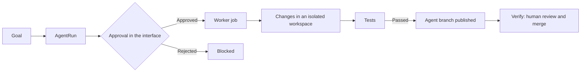
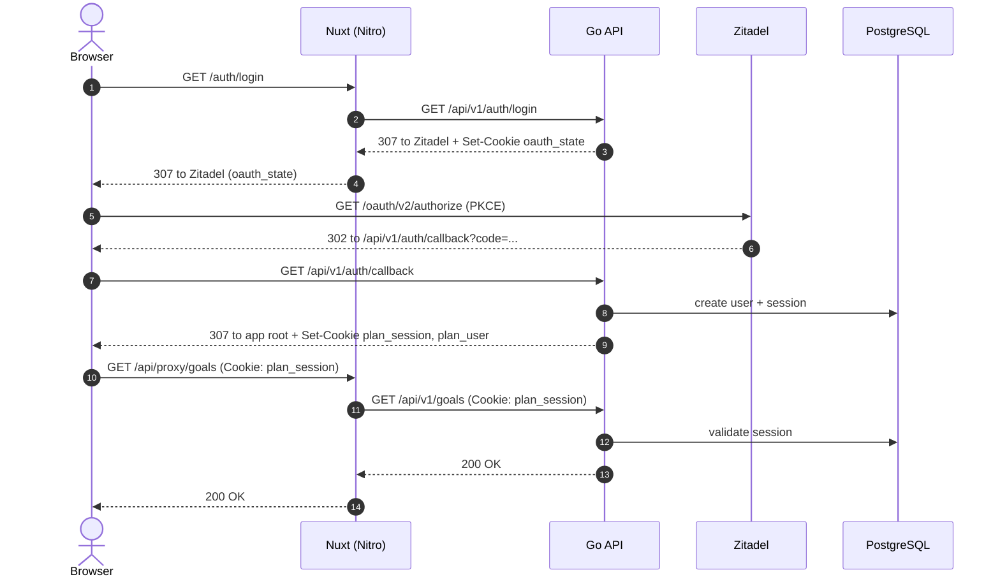
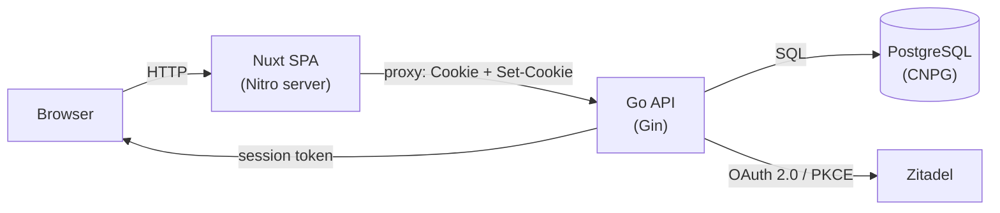
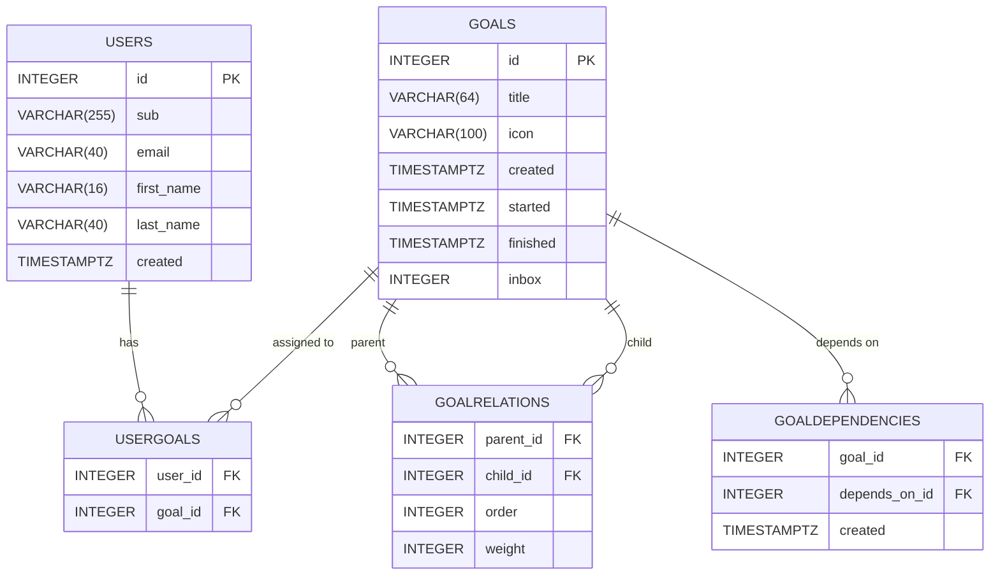

# Plan - Goal Management Application

A goal management and planning application that helps users organize and track
their objectives using a modern web interface with hierarchical goal structures.

## Tech Stack

- **Frontend**: Nuxt 4, TypeScript, Tailwind CSS
- **Backend**: PostgreSQL database
- **Testing**: Vitest, Cucumber.js
- **Deployment**: Kubernetes

## Agent Platform

Plan can delegate a goal to an agent through a tracked `AgentRun`. The run and
its lifecycle are stored in the `agent_runs` table, so the interface can show
the agent's progress even when the agent worker is temporarily unavailable.

### Run lifecycle

1. A goal starts an `AgentRun` in the `define` phase with `queued` status.
2. The worker starts the run and changes its status to `running`.
3. The agent works through the `plan` and `execute` phases. If it needs human
   input or approval, the run is marked `blocked` and the decision is made in
   the Plan interface.
4. After approval, a worker job such as `agent-worker-run-72` applies the
   changes in an isolated workspace and runs the relevant tests.
5. If the tests pass, the agent publishes a dedicated branch, for example
   `agent/goal-540-run-72`, and marks the run `done` in the `verify` phase.
   The run is marked `failed` if the work cannot be completed successfully.
6. The `verify` phase requires human review and merge. Changes are never
   applied directly to the `main` branch by the agent.

The worker job is tied to the lifetime of the run and terminates when the run
is complete. The final merge decision remains with a human reviewer.

### Persisted state

Each `AgentRun` belongs to a goal and records its current phase, status,
summary, optional artifact URL, cost, conversation ID, and timestamps.

| Field | Values |
| --- | --- |
| `phase` | `define`, `plan`, `execute`, `verify`, `completed` |
| `status` | `queued`, `running`, `blocked`, `done`, `failed` |

## Authentication

The session lives in the **Go API** - not in Nuxt. Go creates, validates and
deletes the session and sets the cookies; Nuxt is a thin proxy in front of it.

Rules:

- **Go owns the session.** `plan_session` (httpOnly) is set by the Go API in
  the login response - the session token never travels in a URL.
- **Nuxt is a thin proxy** (`server/utils/goApi.ts`): it forwards the `Cookie`
  header and copies back `Set-Cookie` and `Location`. It never follows
  redirects itself, otherwise the OAuth redirect would be resolved server-side
  instead of in the browser.
- **One session, two ways in**: the `plan_session` cookie for browsers,
  `Authorization: Bearer <token>` for API clients.
- **`plan_user`** is a readable hint cookie (sub + email) so the UI can render
  immediately. It is not authoritative - the server validates the session on
  every request.
- **Logout** (`POST /api/v1/auth/logout`) deletes the session server-side and
  clears the cookies.
- **Dev login** (`POST /api/v1/auth/dev-login`) creates a session for
  `dev-user` without Zitadel. It only exists when `DEV_AUTH_ENABLED=true`.

## Database Schema

