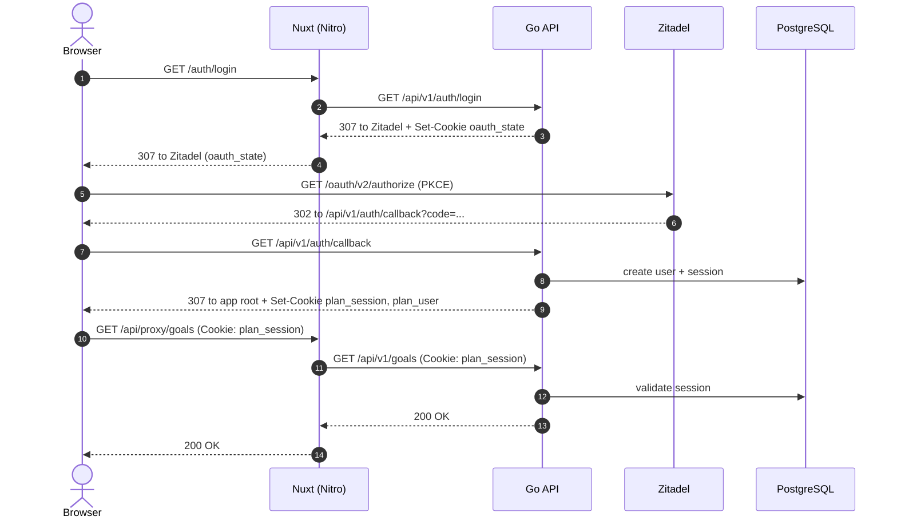
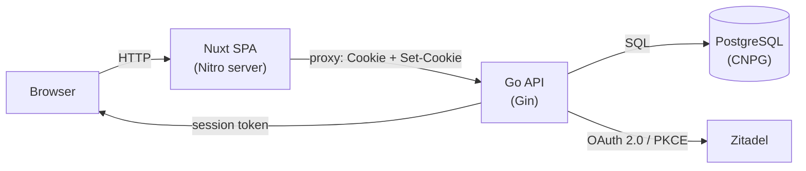
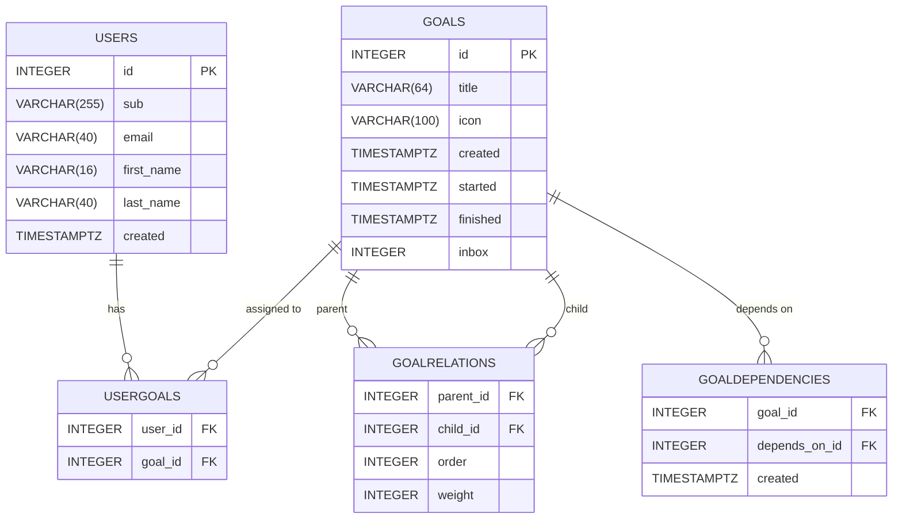

# Plan

Plan är kontrollplanet för både livsplanering och agentkörningar. Agentmotorn
ligger i samma repository under `src/agent` och körs som en separat tjänst.

| Dokument                                                               | Innehåll                                    |
| ---------------------------------------------------------------------- | ------------------------------------------- |
| [`docs/agent-platform.md`](docs/agent-platform.md)                     | Arkitektur, körningsflöde, säkerhetsgränser |
| [`docs/development.md`](docs/development.md)                           | Utveckling i dev, Tilt, portar              |
| [`docs/checkpoint-gate-workflow.md`](docs/checkpoint-gate-workflow.md) | Arbetsflöde för stora förändringar          |
| [`docs/design/`](docs/design)                                          | Designspråk för gränssnittet                |

## Goal Management Application

A goal management and planning application that helps users organize and track
their objectives using a modern web interface with hierarchical goal structures.

## Tech Stack

- **Frontend**: Nuxt 4, TypeScript, Tailwind CSS
- **Backend**: PostgreSQL database
- **Testing**: Vitest, Cucumber.js
- **Deployment**: Kubernetes

## Authentication

The session lives in the **Go API** - not in Nuxt. Go creates, validates and
deletes the session and sets the cookies; Nuxt is a thin proxy in front of it.

Rules:

- **Go owns the session.** `plan_session` (httpOnly) is set by the Go API in the
  login response - the session token never travels in a URL.
- **Nuxt is a thin proxy** (`server/utils/goApi.ts`): it forwards the `Cookie`
  header and copies back `Set-Cookie` and `Location`. It never follows redirects
  itself, otherwise the OAuth redirect would be resolved server-side instead of
  in the browser.
- **One session, two ways in**: the `plan_session` cookie for browsers,
  `Authorization: Bearer <token>` for API clients.
- **`plan_user`** is a readable hint cookie (sub + email) so the UI can render
  immediately. It is not authoritative - the server validates the session on
  every request.
- **Logout** (`POST /api/v1/auth/logout`) deletes the session server-side and
  clears the cookies.
- **Dev login** (`POST /api/v1/auth/dev-login`) creates a session for `dev-user`
  without Zitadel. It only exists when `DEV_AUTH_ENABLED=true`.

## Database Schema

## Agent Platform

Plan can delegate implementation work for a goal to an agent. Each delegation is
represented by an **AgentRun**, linked to the goal it serves. Plan owns the run
metadata in the `agent_runs` table, so the interface can display the agent's
progress even when the agent worker is temporarily unavailable.

### Run lifecycle

An agent run moves through the following phases:

1. **define** - clarify the goal and acceptance criteria.
2. **plan** - inspect the repository and propose the implementation.
3. **execute** - make the requested changes in an isolated workspace.
4. **verify** - run the relevant tests and present the result for human
   approval.
5. **completed** - publish the verified branch for review and merge.

A run has one of these statuses: `queued`, `running`, `blocked`, `done`,
`failed`, or `cancelled`. `blocked` means that the agent cannot continue without
input or a decision; it is not an automatic failure. `cancelled` means that a
human stopped the run - the run keeps its history, and the Kubernetes job is
cleaned up.

### Approval and delivery

Agent work is not merged automatically. At the verify phase, the implementation
and its test results require **human approval** in the Plan interface. Once
approved, the agent applies the change in its isolated workspace, runs the
tests, and publishes a dedicated branch named `agent/goal-<id>-run-<run-id>`
(for example, `agent/goal-540-run-70`).

The worker job for a run is named `agent-worker-run-<run-id>`. The run's
summary, conversation reference, artifact URL, and cost are stored in Plan so
that the delivery can be reviewed from the same interface as the original goal.

A complete delivery therefore has the following chain:

1. A goal starts an AgentRun.
2. The agent worker executes the run.
3. The implementation reaches verify and waits for human approval.
4. The approved change is applied in an isolated workspace.
5. The relevant tests run successfully.
6. The agent publishes its branch for human review and merge.

### Cost and budgets

Plan owns the cost. The agent only reports token usage, and Plan prices it from
a versioned price list, so that every run is priced the same way and the cost
can be reproduced later. A budget has a period, a hard limit, an optional
warning limit, and can be limited to a single agent. Before a run starts, the
spent and the reserved cost are checked in the same transaction as the run is
created - two simultaneous runs can therefore never exceed the limit together.
The overview lives at `/agent-cost` in the interface.
