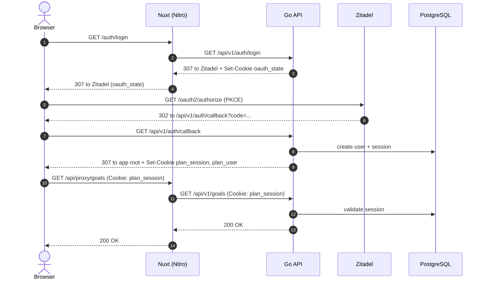
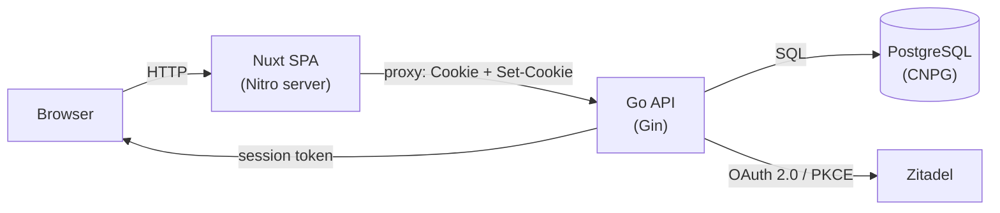
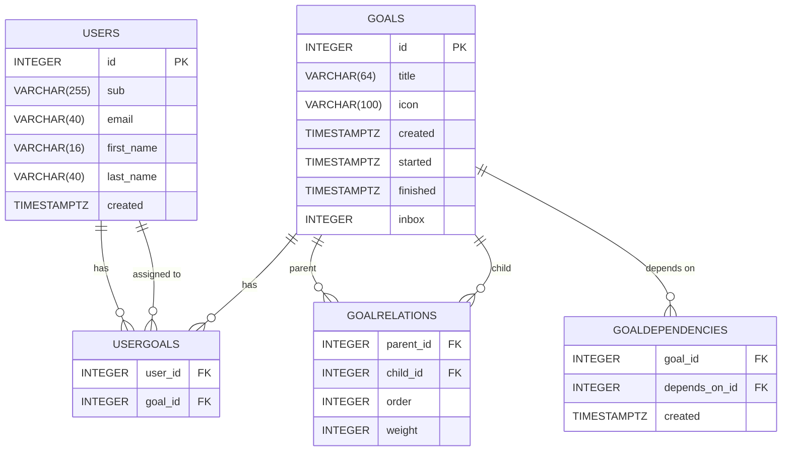

# Plan - Goal Management Application

A goal management and planning application that helps users organize and track
their objectives using a modern web interface with hierarchical goal structures.

## Agentplattform

### Mål och problem

Agentplattformen hjälper användare att utföra arbete kopplat till sina mål
utan att hela flödet behöver automatiseras. Den sammanför mål, agentarbete och
mänsklig granskning så att användaren kan följa arbetet, fatta beslut och se
resultatet av varje körning.

### AgentRun

En `AgentRun` skapas för ett mål och representerar en enskild agentkörning mot
det målet. När körningen startar får den en aktuell fas och status, och den kan
därefter gå vidare mot nästa del av arbetet. `AgentRun` är den centrala
enheten som visar vad agenten har arbetat med och var körningen befinner sig.

### Human gate

En human gate används när plattformen kräver mänsklig granskning innan
körningen får fortsätta. Vid en human gate presenteras resultatet för
granskning; godkännande låter körningen fortsätta, medan ett underkänt eller
ej godkänt beslut stoppar körningen. Exakt vilka steg som kräver granskning
bestäms av den aktuella körningen.

### Körningshistorik

Körningshistoriken samlas i Plan så att agentens tidigare körningar och
resultat finns tillgängliga även när en ny körning inte är aktiv. Historiken
visas tillsammans med målet. Historiken används för att följa upp status,
gransknings- och godkännandeslut samt eventuella misslyckanden.

## Tech Stack

- **Frontend**: Nuxt 4, TypeScript, Tailwind CSS
- **Backend**: PostgreSQL database
- **Testing**: Vitest, Cucumber.js
- **Deployment**: Kubernetes

## Authentication

The session lives in the **Go API** - not in Nuxt. Go creates, validates and
deletes the session and sets the cookies; Nuxt is a thin proxy in front of it.

Rules:

- **Go owns the session.** `plan_session` (httpOnly) is set by the Go API in
  the login response - the session token never travels in a URL.
- **Nuxt is a thin proxy** (`server/utils/goApi.ts`): it forwards the `Cookie`
  header and copies back `Set-Cookie` and `Location`. It never follows
  redirects itself, otherwise the OAuth redirect would be resolved server-side
  instead of in the browser.
- **One session, two ways in**: the `plan_session` cookie for browsers,
  `Authorization: Bearer <token>` for API clients.
- **`plan_user`** is a readable hint cookie (sub + email) so the UI can render
  immediately. It is not authoritative - the server validates the session on
  every request.
- **Logout** (`POST /api/v1/auth/logout`) deletes the session server-side and
  clears the cookies.
- **Dev login** (`POST /api/v1/auth/dev-login`) creates a session for
  `dev-user` without Zitadel. It only exists when `DEV_AUTH_ENABLED=true`.

## Database Schema

