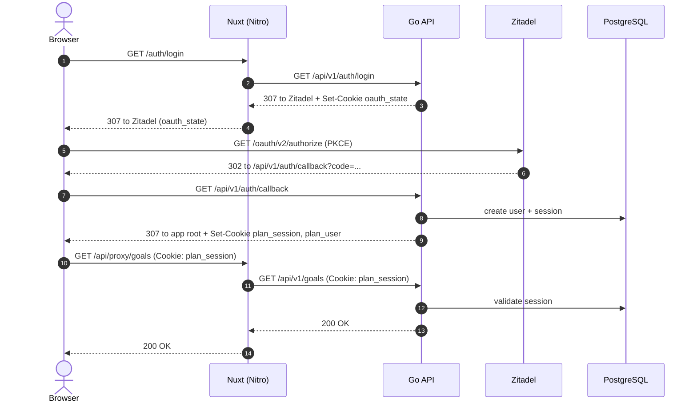
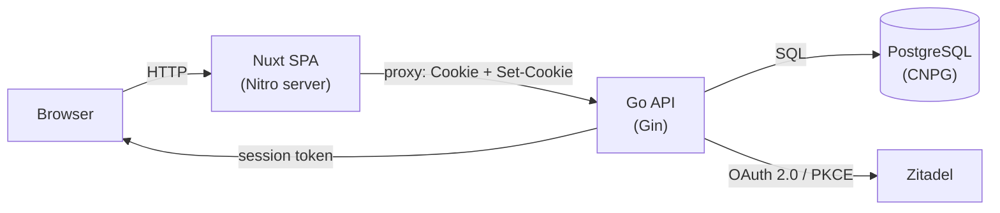
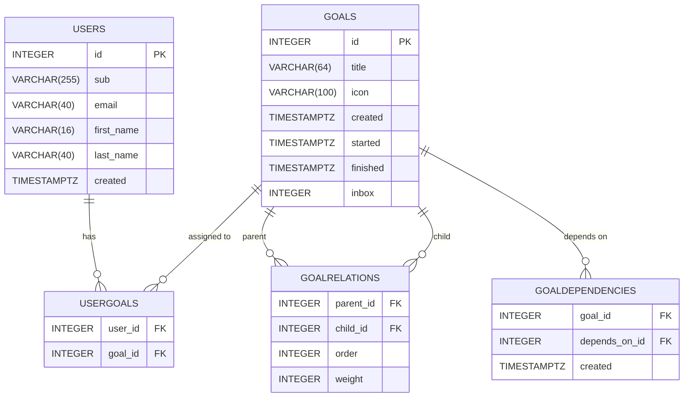

# Plan - Goal Management Application

A goal management and planning application that helps users organize and track
their objectives using a modern web interface with hierarchical goal structures.

## Tech Stack

- **Frontend**: Nuxt 4, TypeScript, Tailwind CSS
- **Backend**: PostgreSQL database
- **Testing**: Vitest, Cucumber.js
- **Deployment**: Kubernetes

## Agent Platform

The agent platform connects a goal to an autonomous coding run. Plan records each
attempt as an `AgentRun`, including its phase, status, summary, cost, and any
artifact produced by the agent.

### Agent run lifecycle

An agent run progresses through the goal workflow:

1. **Define** - the goal and acceptance criteria are clarified.
2. **Plan** - the implementation approach is prepared.
3. **Execute** - the agent implements the change in an isolated workspace.
4. **Verify** - the agent runs the relevant tests and prepares the result for
   human review.
5. **Completed** - the run is finished and its outcome is recorded.

Runs can also be `blocked` or `failed`. A blocked run requires attention before
it can continue.

### Human approval

Changes are not merged automatically. Before the agent applies and delivers a
change, a person reviews and approves the proposed change in the interface.
The approval links the requested action to a specific agent run and is recorded
by the platform.

### Isolated workspace and delivery

An approved run is applied in an isolated workspace so it does not modify the
main branch directly. The agent:

1. applies the approved change in the isolated workspace;
2. runs the project's tests;
3. publishes the completed work on a dedicated `agent/...` branch;
4. leaves the main branch unchanged; and
5. ends the worker job as soon as the run is complete.

The branch and the `AgentRun` summary provide the reviewer with the context
needed to inspect the change and merge it. The platform also records a
conversation identifier and artifact URL when those are available, allowing
the UI to show the agent's work even when the agent service is temporarily
unavailable.

## Authentication

The session lives in the **Go API** - not in Nuxt. Go creates, validates and
deletes the session and sets the cookies; Nuxt is a thin proxy in front of it.

Rules:

- **Go owns the session.** `plan_session` (httpOnly) is set by the Go API in
  the login response - the session token never travels in a URL.
- **Nuxt is a thin proxy** (`server/utils/goApi.ts`): it forwards the `Cookie`
  header and copies back `Set-Cookie` and `Location`. It never follows
  redirects itself, otherwise the OAuth redirect would be resolved server-side
  instead of in the browser.
- **One session, two ways in**: the `plan_session` cookie for browsers,
  `Authorization: Bearer <token>` for API clients.
- **`plan_user`** is a readable hint cookie (sub + email) so the UI can render
  immediately. It is not authoritative - the server validates the session on
  every request.
- **Logout** (`POST /api/v1/auth/logout`) deletes the session server-side and
  clears the cookies.
- **Dev login** (`POST /api/v1/auth/dev-login`) creates a session for
  `dev-user` without Zitadel. It only exists when `DEV_AUTH_ENABLED=true`.

## Database Schema

