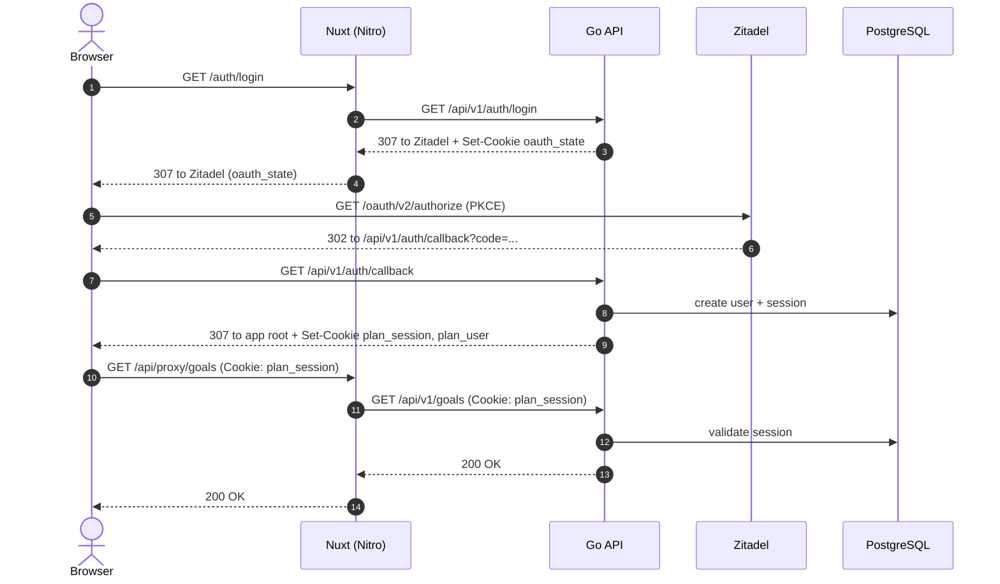
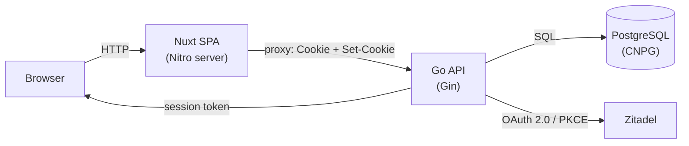
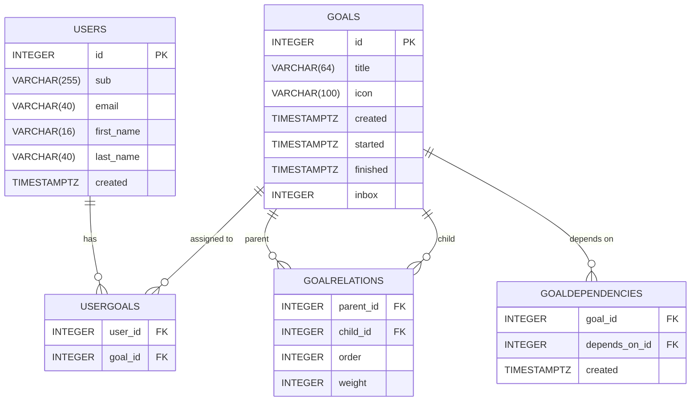

# Plan - Goal Management Application

A goal management and planning application that helps users organize and track
their objectives using a modern web interface with hierarchical goal structures.

## Tech Stack

- **Frontend**: Nuxt 4, TypeScript, Tailwind CSS
- **Backend**: PostgreSQL database
- **Testing**: Vitest, Cucumber.js
- **Deployment**: Kubernetes

## Authentication

The session lives in the **Go API** - not in Nuxt. Go creates, validates and
deletes the session and sets the cookies; Nuxt is a thin proxy in front of it.

Rules:

- **Go owns the session.** `plan_session` (httpOnly) is set by the Go API in
  the login response - the session token never travels in a URL.
- **Nuxt is a thin proxy** (`server/utils/goApi.ts`): it forwards the `Cookie`
  header and copies back `Set-Cookie` and `Location`. It never follows
  redirects itself, otherwise the OAuth redirect would be resolved server-side
  instead of in the browser.
- **One session, two ways in**: the `plan_session` cookie for browsers,
  `Authorization: Bearer <token>` for API clients.
- **`plan_user`** is a readable hint cookie (sub + email) so the UI can render
  immediately. It is not authoritative - the server validates the session on
  every request.
- **Logout** (`POST /api/v1/auth/logout`) deletes the session server-side and
  clears the cookies.
- **Dev login** (`POST /api/v1/auth/dev-login`) creates a session for
  `dev-user` without Zitadel. It only exists when `DEV_AUTH_ENABLED=true`.

## Database Schema

